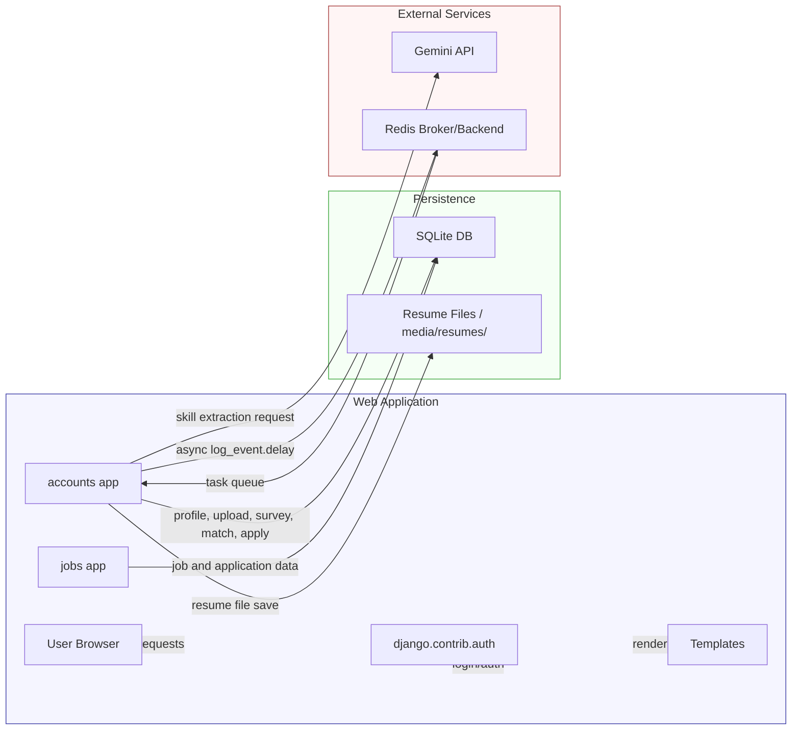
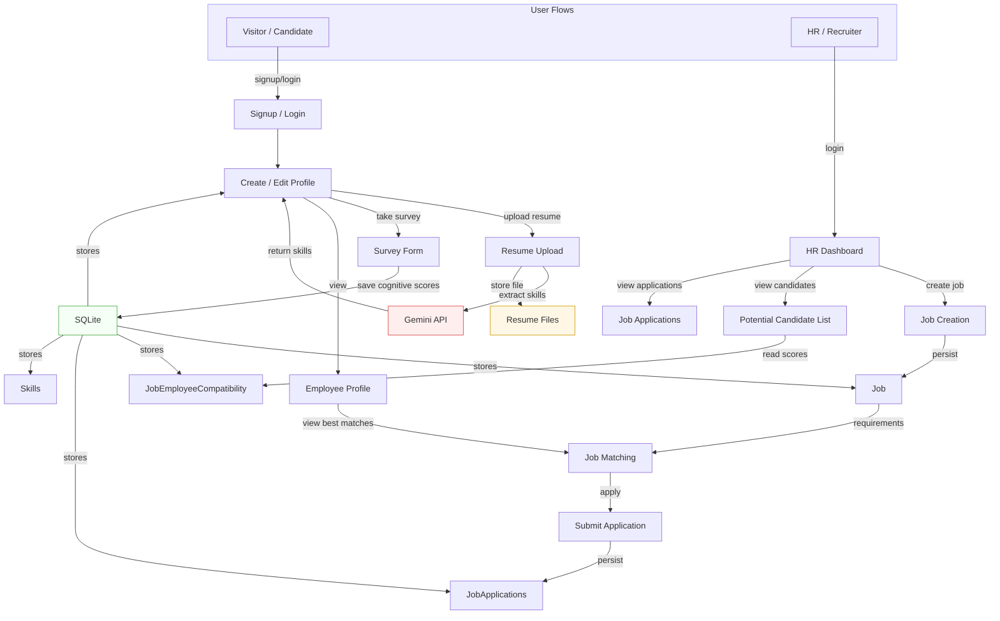
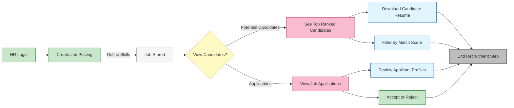

# Job Recommendation System Architecture

## System Overview

This repository implements a Django-based job recommendation platform with two main apps:
- `accounts`: employee profile management, resume upload, survey input, skill extraction, and job matching
- `jobs`: job creation, listing, candidate recommendations, and applications

The system includes:
- Django web frontend using templates under `templates/`
- SQLite database stored at `db.sqlite3`
- Resume storage in `media/resumes/`
- Gemini API integration for resume skill extraction via `accounts/skills_extraction.py`
- Celery task support for asynchronous logging (`accounts/tasks.py`) with Redis broker / result backend
- Security and authentication using Django auth plus `django-axes` for login rate limiting

## Architecture Diagram



## System Overview Diagram



## Key Components

- `accounts/models.py`
  - `employee_account`: stores candidate and HR profiles, resume metadata, extracted skills, cognitive scores
- `jobs/models.py`
  - `Job`: job postings with required skills and cognitive target scores
  - `JobSkillRequirement`: job-specific skill importance weights
  - `JobEmployeeCompatibility`: computed match score per employee-job pair
  - `JobApplications`: candidate applications for jobs
- `accounts/views.py`
  - handles signup, profile management, resume upload, skill extraction, survey input, job matching, apply-to-job, and secure resume download
- `jobs/views.py`
  - handles job listing, job creation, HR candidate recommendations, and application viewing
- `accounts/skills_extraction.py`
  - anonymizes resume text and calls Gemini API to extract structured skill lists
- `mysite/settings.py`
  - configures database, static/media, Celery/Redis, and login security

## Notes

- Current task queue support is limited to `log_event` and demo logging, but the architecture already supports asynchronous Celery workflows.
- The matching engine in `accounts/views.py` combines skill coverage and cognitive score distance into a compound compatibility score.
- Resume files are stored under `media/resumes/` and served through `SecureResumeDownloadView` with owner/HR authorization.

---

# Simplified Operations & Workflows

## Candidate Operations Flow

This diagram shows the core candidate journey from signup through to receiving ranked job matches.

```mermaid
flowchart LR
    A[Candidate Sign Up] --> B[Upload CV/Resume]
    B -->|Gemini API| C[Extract Skills]
    C --> D[Skills Stored]
    D --> E[Complete Survey]
    E -->|Cognitive Scores| F[Scores Stored]
    F --> G[Trigger Matching Algorithm]
    G -->|Compute Score| H[Calculate Compatibility]
    H --> I[Ranked Job Results]
    I --> J[View Matches]
    J --> K{Apply?}
    K -->|Yes| L[Submit Application]
    K -->|No| J
    
    style A fill:#e1f5ff,stroke:#01579b
    style B fill:#e1f5ff,stroke:#01579b
    style C fill:#fff3e0,stroke:#e65100
    style D fill:#f5f5f5,stroke:#424242
    style E fill:#e1f5ff,stroke:#01579b
    style F fill:#f5f5f5,stroke:#424242
    style G fill:#fff3e0,stroke:#e65100
    style H fill:#fff3e0,stroke:#e65100
    style I fill:#c8e6c9,stroke:#2e7d32
    style J fill:#e1f5ff,stroke:#01579b
    style L fill:#f3e5f5,stroke:#512da8
```



## HR Recruiter Operations Flow

This diagram shows the HR recruiter workflow for job management and candidate review.



## Combined System Operations

This diagram shows both candidate and HR operations interacting through the recommendation system.

```mermaid
flowchart TD
    subgraph Candidate["CANDIDATE JOURNEY"]
        C1[Signup and Login]
        C2[Upload Resume]
        C3[System Extracts Skills via Gemini API]
        C4[Complete Survey Cognitive Scores]
        C5[System Computes Match]
        C6[View Ranked Jobs]
        C7[Apply for Job]
        
        C1 --> C2 --> C3 --> C4 --> C5 --> C6 --> C7
    end
    
    subgraph System["MATCHING ENGINE"]
        M1["Candidate Profile"]
        M2["Job Requirements"]
        M3["Calculate Compatibility"]
        M4["Store in Database"]
        
        M1 --> M3
        M2 --> M3
        M3 --> M4
    end
    
    subgraph HR["HR RECRUITER JOURNEY"]
        H1[Login to Dashboard]
        H2[Create Job Posting]
        H3[View Potential Candidates]
        H4[Review Applications]
        H5[Download Resumes]
        H6[Make Hiring Decisions]
        
        H1 --> H2 --> H3 --> H4 --> H5 --> H6
    end
    
    C5 -.->|Stores Candidate Data| M1
    C2 -.->|Stores Job Requirements| M2
    M4 -.->|Ranked Results| C6
    M4 -.->|Top Candidates| H3
    C7 -.->|Application| H4
    
    style Candidate fill:#e3f2fd,stroke:#1976d2,stroke-width:2px
    style HR fill:#f3e5f5,stroke:#7b1fa2,stroke-width:2px
    style System fill:#fff3e0,stroke:#e65100,stroke-width:2px
